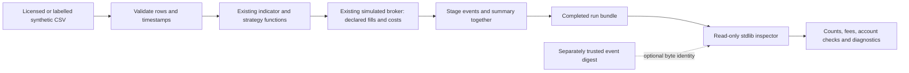

# Provenance, engineering contribution and learning record

## Origin and contribution boundary

Oscar wrote the original WQT 2025 competition bot. This public repository is a separate
post-competition rebuild with an exchange-agnostic broker boundary and blueprint adapters.
It uses an example strategy; no prize, placement, trading performance, production deployment or
product adoption follows from these engineering checks. Existing team/upstream attribution and
the Apache 2.0 license remain in the repository. The additions use the public source and labelled synthetic fixtures.

The replay and inspection work adds strict imported-OHLCV validation, optional deterministic
decision/fill/account audit bundles, failure cleanup, input-alias protection and a read-only saved
audit inspector. The inspector uses Python's standard library and a separate arithmetic pass;
it does not call the producer's broker/strategy to decide whether a saved account balances.
The inspector leaves the replay producer, live broker/trader, configuration, dependencies and
prior assertions unchanged. The replay extension preserves the original default numeric golden. AI coding agents implement under Oscar's design and review;
the local git record identifies the exact authorship and assistance. Independent acceptance is a
separate record, not implied by an author test pass.

## Architecture and useful operation

A developer can bring data in a documented format, find a bad cell before running a simulation,
trace why an entry/exit occurred, inspect the charged costs and reconcile a saved run after copying
it. The CLI is the supported product interface; a useful browser view could consume the same
actual records, with editable input and visible errors. No decorative dashboard or live-account
connection is necessary to demonstrate this capability.

## What was difficult and what the evidence showed

| Problem / approach | Observed evidence / decision |
|---|---|
| Aggregates hid the actual decision and account path | Add optional streamed JSONL from the existing loop; default numeric results still match the original golden. |
| CSV conversion admitted NaN and impossible OHLC | Add row/field diagnostics and finite/range constraints; retain valid zero-volume rows and gaps without fabricating replacements. |
| Path resolution protected symlinks but missed hardlinks | A failing hardlink reproduction showed input corruption was possible; file-identity checking fixed the alias class. |
| Python treats numeric 1 and boolean true as equal | A failing saved-audit case showed the schema check accepted 1; the supported boolean assumption now uses a strict identity check. |
| A digit-only timeframe can exceed Python's integer parsing limit | The author probe and root review independently reproduced an exit-1 traceback; a new regression requires exit 2 and a file/line/timeframe diagnostic. The parser handles that conversion error without changing Python's limits. |
| Parsing JSON does not reconcile a trading account | Reconstruct prices, costs, quantity, cost basis and cash independently; compare with actual saved fields and completion/summary. |
| Self-consistent edits can still describe fabricated data | Report the consistency scope; compare event bytes to a separately trusted digest when identity is required. |
| A naive test could fail for a second guard instead | Use otherwise-valid duplicate-key and oversized-record controls, joint summary/completion edits, source mutants and an independent exact-decimal oracle. |

The decimal controls use binary-rational prices/fees so equality is exact and not hidden behind a
widened tolerance. Those fees are arithmetic test inputs, not market cost estimates. The normal
130-bar fixture uses separately declared costs and real shared computation on labelled synthetic
data. The saved-audit inspector does not certify signal quality or independently recompute the
summary's risk ratios.

## Engineering principles

These properties can be checked directly in the implementation and tests:

- Fill-price arithmetic and account admission are distinct: the replay has independent cash per
  symbol; the paper broker shares cash across symbols and refuses uncovered whole orders.
- Protecting a source file requires both resolved-path and file-identity checks, including
  symlink and hardlink aliases.
- Staging the event stream and summary as one directory distinguishes interrupted computation
  from a completed run. Directory publication is not a power-loss durability guarantee.
- Execution-model consistency and data authenticity need separate evidence. The digest option
  checks saved event bytes against a separately trusted digest; it does not validate the market.

## Compatibility, CI and release evidence

- Documented setup: Python 3.11+ and pinned requirements for producing a replay. The inspector alone
  is exercised with `python -S`, proving it does not depend on installed trading packages.
- Existing CI invokes `PYTHON=python bash scripts/check.sh` on Python 3.11 and 3.12. New integration
  and property files are collected by those existing tier commands; no workflow/check is replaced.
- The local full gate passed on Python 3.11: 54 case, 59 integration and 6 property tests,
  Ruff, mypy (16 files), adapter conformance, vendor controls/mutants and the original synthetic
  golden. A separate review reproduced a malformed-timeframe failure, then confirmed the repair
  and independently reran the full gate. The source pins are in [validation.json](validation.json).
- Remote checks for each proposed revision are available in its GitHub pull request. A local
  pass is not evidence of a remote run, another Python version, production use or deployment.

The [replay guide](PAPER_REPLAY.md) gives runnable commands, failure recovery and fill-model limits.
